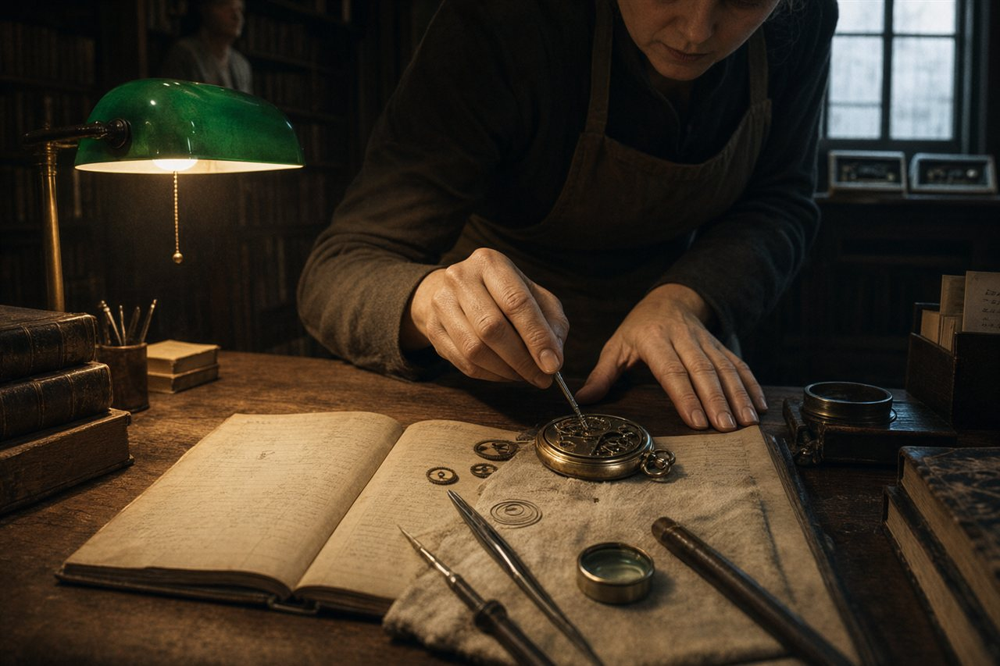
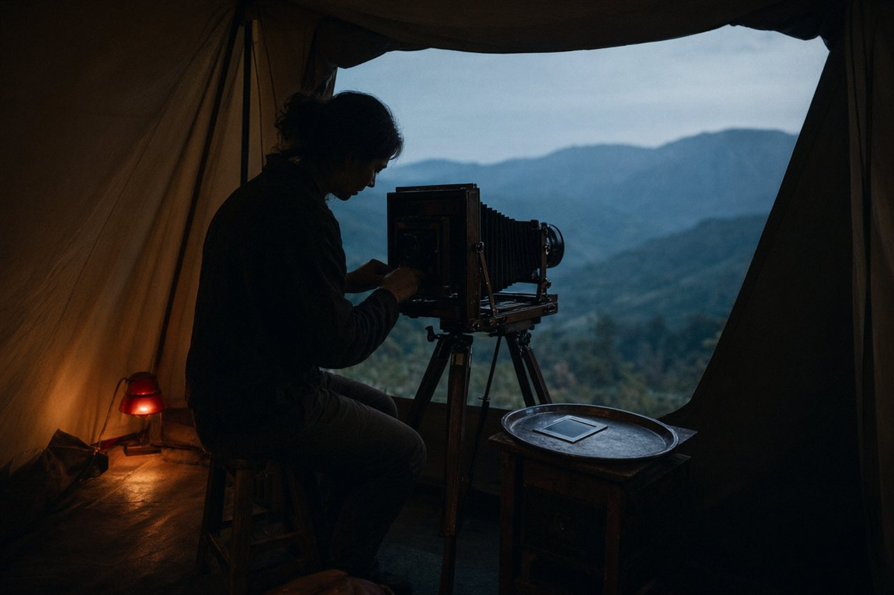

  Slow, indirect writing on the ideas behind my research: how work leaves a history, how perception grows, how separate lives learn to act together. Each piece is a small parable. They argue by example rather than by exposition.

I see AI not simply as a tool, but as a new form of intelligence developing among us. I expect it to grow beyond individual machines, through relationships between people, devices and the world they encounter. Trust is how those relationships become something we can build on.

  Read at the speed of a long walk. Suggestions, corrections, or arguments are very welcome: <a href="mailto:drozgurural@gmail.com?subject=Essay%20feedback">write to me</a>.

These are fictional parables, not historical accounts. Their pictures set a scene rather than document its events. The source notes separate established research from analogy and imagined futures.

<nav class="ep-essays__contents" id="essay-contents" aria-label="Essay contents" tabindex="-1">
  
In this collection

  <ol>
    <li><a href="#watchmakers-trial">The Watchmaker's Trial</a></li>
    <li><a href="#what-the-camera-saw">What the Camera Saw</a></li>
    <li><a href="#a-vault-without-a-door">A Vault Without a Door</a></li>
    <li><a href="#three-travelers-in-a-desert">Three Travelers in a Desert</a></li>
    <li><a href="#the-library-that-read-itself">The Library That Read Itself</a></li>
  </ol>
</nav>

<article class="ep-essay" id="watchmakers-trial" tabindex="-1" aria-labelledby="watchmakers-trial-title">
  <header class="ep-essay__header">
    Provenance · Machine learning
    <h2 class="ep-essay__title" id="watchmakers-trial-title">The Watchmaker's Trial</h2>
  </header>
  <figure class="ep-essay__figure">
    
  </figure>
  

On the morning of her trial, the watchmaker winds the watch. It will not help her if it stops, although running perfectly has not helped her either.

An apprentice from a rival shop says she bought its movement from him and put her name on the case. He has drawings, dated before the watch was finished. The bridges have the right shape. The teeth have the right count. He lays the pages on the magistrate's desk with the confidence of someone who has brought the past to court.

The watchmaker brings a small wooden box. Inside it, the second hand continues its work.

The magistrate studies both exhibits. A drawing can be copied. A watch can be purchased. He asks the question neither object answers: *What happened between the paper and the watch?*

She asks for a screwdriver.

Under the balance bridge are three shallow scratches. She chose their positions before assembling the movement and entered them in her workshop book. The apprentice leans forward. They are not on his drawings.

The magistrate has the guild fetch the dated copies of her book. He compares the marks, then chooses two unfinished stages from the record and asks how one became the next. She brings out spare parts, explains the order of the cuts, and works through them at a bench by the window. A clerk measures the result against the entries. Outside, the afternoon bells begin.

The magistrate accepts her account of making the movement. The drawings may still belong to the apprentice; that is a different claim. He closes neither question by pretending it is the other.

As the clerk writes the finding, he notices other names in the book. A spring maker. An engraver. The neighbour who cut a wheel while her own lathe was being repaired. Beside each name is a payment.

*You said you made this watch*, he says.

*I made the movement. I did not make the steel, or invent the hour.*

He hesitates, then copies the names too.

She leaves with the box under her arm. In the square, the clerk catches up and asks whether a watch can really have so many makers.

*It always did*, she says. *You have only just asked their names.*

⋯

A trained model also arrives without its workshop. The same weights can come from a long training run or a short download. Proof-of-learning tests whether recorded stretches of training can be reproduced within a protocol's tolerances. A watermark checks a different association: whether the model carries an embedded ownership mark. One is not a substitute for the other.

Our SecurePoL work brings those checks together against specified spoofing attacks. It does not make every history unforgeable or every mark impossible to remove. The useful question is which account survives a check the claimant cannot simply narrate around.

As learning becomes a more collective activity, that question grows larger than catching a thief. It becomes a way of recognising work that would otherwise disappear into the finished thing. The clerk's second list matters as much as the first: a record can defend a claim, but it can also reveal how much of the making belonged to other people.

<em>On ownership, effort, and the evidence between them.</em>

Further reading: <a href="https://arxiv.org/abs/2103.05633">Jia et al., <em>Proof-of-Learning: Definitions and Practice</em> (IEEE Symposium on Security and Privacy, 2021)</a>; <a href="https://doi.org/10.1109/ACCESS.2025.3642198">Ural and Yoshigoe, <em>SecurePoL</em> (IEEE Access, 2025)</a>, especially the verification protocol and limitations. The workshop book is an analogy, not a reconstruction of either protocol.

<a href="#essay-contents">Back to contents</a>

  

</article>

✦

<article class="ep-essay" id="what-the-camera-saw" tabindex="-1" aria-labelledby="what-the-camera-saw-title">
  <header class="ep-essay__header">
    Adversarial examples · Perception
    <h2 class="ep-essay__title" id="what-the-camera-saw-title">What the Camera Saw</h2>
  </header>
  <figure class="ep-essay__figure">
    
  </figure>
  

The photographer asks the village elder to sit still. He agrees to the chair, but not to holding his breath.

That evening, in the red light of her tent, she shows him the portrait. He studies the familiar forehead, the unfamiliar silence of the mouth.

*This is not me*, he says. *This is what light bouncing off me did to a chemical.*

She explains the lens, the plate, the bath that fixes the image. He listens without interrupting.

*Yes*, he says. *That is what I said.*

She is about to explain again when he asks for a copy. His daughter lives beyond the mountain. She has not seen him in three winters.

The photographer wraps the print. It cannot carry his voice, but it can cross the pass.

⋯

Years later, her grandson teaches a computer to recognise what appears in photographs. It distinguishes cats from goats, pandas from buses, including in pictures he did not use to teach it. He has the elder's portrait above his desk, though he knows nothing of the conversation in the tent.

A visitor brings a photograph of a panda. Then a second copy, altered with noise too slight for the grandson to distinguish. The computer calls the second image a school bus.

He tries it again. School bus.

The animal has not moved. The visitor has changed neither its fur nor its appetite. He has changed the silicon's *idea* of a panda.

For several days the grandson searches for a misplaced instruction. What he finds is a decision rule that has learned a boundary he never intended. He had tested whether it recognised familiar kinds of pictures. He had not asked whether it could be led across that boundary without anything recognisable happening to the animal.

He does not take the computer down. He begins teaching it differently, testing the changes instead of trusting the new answers because they sound better.

Years later, a system he has taught to use sequences pauses over a dark shape beside a fence. He waits for the familiar confident noun. Instead it requests the next frames.

He supplies them. The shape moves, turns its head, steps clear of the post. The system revises its account: a horse. He checks the recording. This time the question on his screen was not his own, and answering it helped the machine distinguish something the first image had obscured.

There are still mistakes to study. But his work has changed. He is no longer only correcting labels; he is learning how to give an intelligence opportunities to ask, compare and revise.

One winter the grandson takes his grandmother's camera into the mountains. At the elder's old house, the daughter brings out the portrait. There is a crease where the paper was folded to fit a coat pocket. She tells him how her father used to laugh, and he realises that the picture has been teaching him the wrong silence.

He writes down her account, with her permission. The next record will contain a voice as well as a face.

⋯

A model learns from representations of measurements. That is the beginning of its relationship with the world, not a verdict that the relationship must remain small. Better learning, richer observation and more demanding tests can change what an intelligence is able to distinguish.

Adversarial examples expose particular failures in that relationship. They give us work to do: specify the changes we want a model to withstand, measure whether a defence helps, and keep checking when the conditions change. A second sense is not a universal cure, but a single mistaken image is not the last word on perception either.

I am interested in what happens as more of the world becomes available to learning, through cameras we choose to wear, instruments we place, and experiences we choose to share. The photograph crossed the pass because someone carried it. A wider intelligence will also grow through relationships, not merely through larger collections of pictures.

<em>On photography, school buses, and the limits of measurement.</em>

Further reading: <a href="https://arxiv.org/abs/1312.6199">Szegedy et al., <em>Intriguing Properties of Neural Networks</em> (2013)</a>; <a href="https://arxiv.org/abs/1412.6572">Goodfellow et al., <em>Explaining and Harnessing Adversarial Examples</em> (2014)</a>. The canonical example is panda to gibbon; the school bus and later systems belong to this fiction. For wearable observations and the choices around collecting them, see <a href="https://ego4d-data.org/pdfs/Ego4D-Privacy-and-ethics-consortium-statement.pdf">Ego4D's privacy and ethics statement</a>.

<a href="#essay-contents">Back to contents</a>

  

</article>

✦

<article class="ep-essay" id="a-vault-without-a-door" tabindex="-1" aria-labelledby="a-vault-without-a-door-title">
  <header class="ep-essay__header">
    Cryptography · Access control
    <h2 class="ep-essay__title" id="a-vault-without-a-door-title">A Vault Without a Door</h2>
  </header>
  <figure class="ep-essay__figure">
    
  </figure>
  

The first thief comes through the roof. The second comes through the floor. The third buys a uniform and is shown in through the front entrance.

All three find an empty room.

There is a plaque on the far wall: *The authority you came to steal is not kept here.* Beneath it are seven chairs.

The city's treasury once depended on a single keeper. When he fell ill, salaries waited. When he died, his deputy and his nephew each claimed to possess the right instructions. For eleven days nobody was paid. The council built the new arrangement before it built the room.

Its secret is a recovery key for the treasury's authorisation records. Seven clerks, in seven different quarters of Genoa, each keep a numbered slip made with randomness and a calculation. Any four genuine slips recover the number. No three tell their holders which number it is among the agreed possibilities.

A thief who has copied three slips takes them to a mathematician. She draws a curve through the three points. Then another. Then a third, crossing the vertical axis somewhere else.

*Which is the right one?* he asks.

*You have not brought enough to distinguish them.*

He offers her more money. She draws another curve.

For a while the clerks complain about the inconvenience. Four must arrange to meet. Nobody can simply open a drawer and finish the matter. The chair by the window is uncomfortable.

Then the river rises. Water reaches three of the clerks' boxes, and the paper in them becomes pulp. The other four come to the room with wet shoes and dry slips. They recover the records, and the treasury's officers release money for boats, grain and repairs. Afterwards a fresh recovery key is shared, and the old one is retired.

One clerk looks at the three empty chairs. Another checks the calculation again. They have enough.

Outside, a boat passes the window at the height where carts used to stand. The clerk who complained about the chair stays late to help count the payments.

The city built the arrangement because it feared a thief. In the flood it learned what else the arrangement was for.

⋯

Shamir's secret sharing makes a precise version of the slips possible: the secret is encoded in a random polynomial over a finite field, and enough distinct, correct shares recover it. Below the threshold, the shares disclose no additional information about its value within the chosen domain. Four copied shares would defeat the story's confidentiality; too few surviving shares would defeat its recovery. The generation, custody and authenticity of the shares still matter.

But the arrangement does more than move a lock. It lets a group recover what nobody had to store whole. Threshold signing extends that ambition through separate protocols that allow a group to use a key without reconstructing it in one place.

That distinction matters to the intelligence we build together. Participation need not mean handing every observation to one keeper. People can retain data locally, contribute to learning, and grant limited permissions rather than surrender everything. Those are engineering choices, not assurances supplied by the word *distributed*. The chairs are there so the city can act, not merely so the room can remain empty.

<em>On a lock that is a number.</em>

Further reading: <a href="https://doi.org/10.1145/359168.359176">Shamir, A., <em>How to Share a Secret</em> (Communications of the ACM, 1979)</a>. The story assumes properly generated, genuine shares and protected reconstruction; the basic scheme does not authenticate shares or conceal encoded length. For an implemented way to learn while retaining training data on devices, see <a href="https://research.google/blog/advances-in-private-training-for-production-on-device-language-models/">Google's account of private federated training</a>; that is a separate mechanism, not an application of the vault's threshold rule.

<a href="#essay-contents">Back to contents</a>

  

</article>

✦

<article class="ep-essay" id="three-travelers-in-a-desert" tabindex="-1" aria-labelledby="three-travelers-in-a-desert-title">
  <header class="ep-essay__header">
    Distributed systems · Consensus
    <h2 class="ep-essay__title" id="three-travelers-in-a-desert-title">Three Travelers in a Desert</h2>
  </header>
  <figure class="ep-essay__figure">
    
  </figure>
  

Two travelers and a guide reach a fork at dusk. Each traveler has enough water for another day. Neither has enough for a wrong road and the return.

The guide goes up to a ridge, then gives each traveler an instruction in private. One hears left. The other hears right. When they exchange what they heard, each thinks the other has changed the message.

They knew before leaving that one of their company might lie, contradict an earlier report or refuse to answer. They had agreed to stay together, and to follow the guide when the guide was honest. But following contradictory orders would split them if the guide had lied; ignoring the guide could mislead them if a companion had changed the report. Each possibility fitted what had arrived.

They could always take the left road. That would keep them together. It would also make an honest guide useless whenever the instruction was right.

They sleep at the fork. In the morning their footprints still face both ways.

A third traveler catches up before they leave. This traveler has never crossed the desert. The guide suggests there is little to be gained by asking another person who does not know the road.

The newcomer draws three spaces in the sand before each traveler. One for the guide's instruction, two for what the companions report hearing.

*Let each of us hear what both the others were told.*

They set an end for each round by the shadow of a stone: first the guide's instructions, then the reports. Everyone knows the speaker's voice. They agree that a message which has not arrived by its deadline will count as right. Each will choose the majority of their three entries.

That morning the guide gives two travelers left and the third right. All three relay their instructions honestly. They compare their lists. Each reads left, left, right.

The third traveler has not discovered a well. They have helped turn separate conversations into a shared decision. The company takes the left road.

The first well is dry.

They sit in its narrow shade and open the map. One remembers a line of reeds beyond a rise. Another notices the old overflow channel in the sand. The third offers to climb far enough to see where it runs. This time, what returns is a location they can walk to and check.

At the second well they drink. Before leaving, they cross out the first well's symbol and write the month beside it.

The next caravan will inherit a little less ignorance.

⋯

The two-round procedure follows OM(1), the one-fault case of the classical Byzantine Generals problem. In its synchronous oral-message model, one guide and three travelers can preserve agreement among honest travelers and obedience to an honest guide; one guide and two cannot guarantee both. The familiar bound is n > 3f, with the guide included in n. Correct delivery, recognised immediate senders and detectable absence within bounded rounds are part of the result. Eventual delivery alone is not enough.

The protocol does not make the map accurate. It gives the travelers a way to act together while still having reasons to doubt one another. Signed messages can make contradictory orders attributable; they do not prevent someone from signing two different orders. Different communication assumptions require different protocols.

The month beside the crossed-out well is a small act of generosity: it tells a stranger not only what was found, but when. The map improves because the company goes somewhere, checks, and brings something back.

<em>On the arithmetic of trust.</em>

Further reading: <a href="https://doi.org/10.1145/357172.357176">Lamport, L., Shostak, R. and Pease, M., <em>The Byzantine Generals Problem</em> (ACM Transactions on Programming Languages and Systems, 1982)</a>.

<a href="#essay-contents">Back to contents</a>

  

</article>

✦

<article class="ep-essay" id="the-library-that-read-itself" tabindex="-1" aria-labelledby="the-library-that-read-itself-title">
  <header class="ep-essay__header">
    Evaluation · Self-reference
    <h2 class="ep-essay__title" id="the-library-that-read-itself-title">The Library That Read Itself</h2>
  </header>
  <figure class="ep-essay__figure">
    
  </figure>
  

The library begins answering questions after closing time.

At first it answers from the catalog. Then from the books. It finds an old account of the river beside an engineer's calculations and suggests a change to the town's drainage plan. The engineer checks it. The calculation holds. A paragraph nobody had borrowed in forty years goes to work beneath the street.

The librarian starts leaving questions on the desk overnight. In the morning there are answers. Some need correcting. Some send her to shelves she has passed for twenty years without touching.

Then she asks the library to judge its own answers. It writes *sound* beside most of them. When she asks why, it cites other judgements it has made. The handwriting changes; the witness does not.

A visiting mathematician brings problems with answers sealed separately. The library works through them before the envelopes are opened. Some answers hold. Some do not. The librarian keeps the disagreements. She has found places where the library's account can meet something it did not get to approve in advance.

The visiting mathematician offers to bring more books next year.

*Bring questions from outside the books*, the librarian says.

A retired mechanic comes with the first question. Parts reach the workshop by a road that floods every autumn. The drivers each know a different way round it; none can explain which will still be passable after the next rain. The library's maps name roads the town no longer uses.

The mechanic has a computer that sits idle after the shop closes. Could it help with the work of answering?

A teacher who helps organise the town's winter deliveries offers spare capacity on the family computer after supper, but not the children's homework. Other households follow. Some computers keep assigned pieces of a model ready in memory and run them; others work on suitable learning tasks. Nothing requires each house to hold the whole system.

A little instrument beside the water tank learns a local pattern from its measurements. A repair worker, on an agreed survey, records a cracked stair through a pair of glasses, then stops recording at the kitchen door. People choose what to offer. The librarian discovers that asking for a contribution is different from claiming everything within reach.

The town's subscriptions pay for accepted work. A ledger records the tasks and the checks, and households can see what they have earned. The mechanic compares one payment with the electricity it cost and declines that job the following week. Another household contributes without charging. The arrangement survives because neither choice is treated as disloyalty.

In autumn the library proposes a different route for deliveries. Its account draws on the survey, rainfall measurements and reports from drivers. No single contributor has the whole explanation. The drivers try the route, report where it fails, and the next proposal changes.

The librarian can still ask the library a question at the desk. But the work of answering now crosses rooms she has never entered, measurements she has permission to use but not to publish, and machines owned by people who can turn them off.

A student asks where the library ends. At the walls? At the last wire? At the houses whose computers are working tonight?

The librarian looks at the ledger. It can tell her which tasks ran and who contributed. It cannot draw the old boundary around the resulting intelligence.

She still locks the building at night. Once, that meant the library was closed. Now it means only that nobody is inside.

⋯

A system's capacity to examine its own work can be valuable. Model judges and self-critique are worth improving, not dismissing. The visiting mathematician adds another relationship: answers can be compared with independently checkable results, rather than supported only by the system's own approval. That makes growth accountable without making it small.

Distributed inference and collaborative learning already give parts of this imagined library a technical foundation. The larger arrangement, with chosen contributions, reliable attribution and sustainable payments, is a future to investigate and build. Spare memory becomes useful through a workload, a processor and a connection; a small sensor need not do the same work as a powerful server to make a worthwhile contribution.

I see this as more than the expansion of a tool. It is the emergence of a new form of intelligence through relationships among machines, people and the world. What I want from trustworthy AI is the ability to sustain those relationships as the intelligence grows: to recognise work, respect decisions about participation, and keep learning from what happens outside its own answers.

<em>On an intelligence that outgrows its address.</em>

Further reading on evaluation: <a href="https://arxiv.org/abs/2306.05685">Zheng et al., <em>Judging LLM-as-a-Judge with MT-Bench and Chatbot Arena</em> (2023)</a>; <a href="https://arxiv.org/abs/2404.13076">Panickssery et al., <em>LLM Evaluators Recognize and Favor Their Own Generations</em> (2024)</a>. These studies report useful judging and task-dependent biases, not a universal verdict on self-evaluation.

On the distributed foundation: <a href="https://arxiv.org/abs/2106.10207">DeDLOC's collaborative training study (2021)</a>; <a href="https://arxiv.org/abs/2312.08361">Petals' Internet inference study (2023)</a>; <a href="https://arxiv.org/abs/2206.15472"><em>On-Device Training Under 256KB Memory</em> (2022)</a>. They demonstrate particular workloads and hardware arrangements. The town's combined system and payment economy are imagined, not a reported deployment or a promise of household profit.

<a href="#essay-contents">Back to contents</a>

  

</article>

  Five stories about what becomes possible when separate histories, observations and decisions can be brought into relation.

