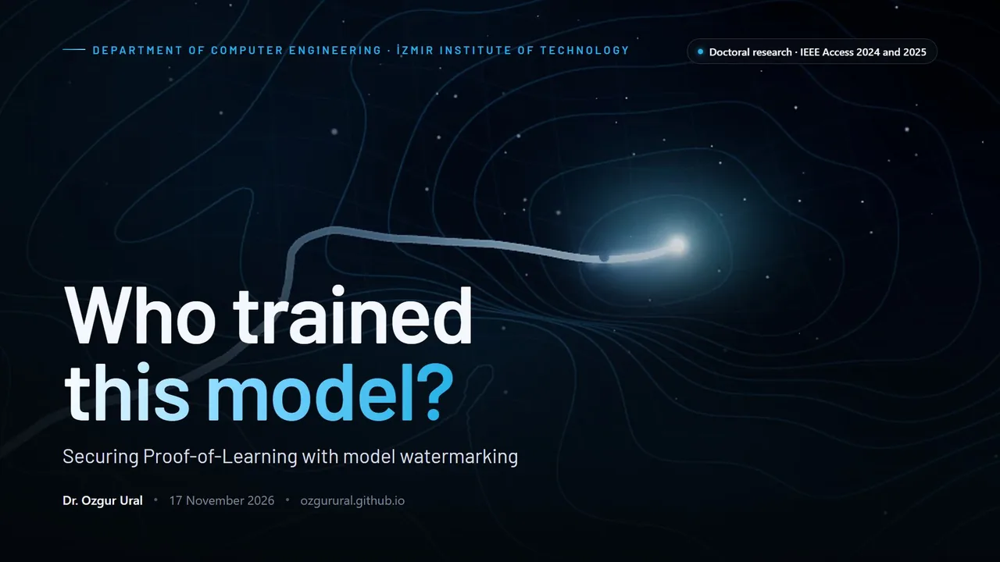

Talks on my research, each with the slides. Some of the same work is explained as narrated films in the <a href="/lab/">Research Lab</a>.

## Who Trained This Model? Securing Proof-of-Learning with Model Watermarking

**Department of Computer Engineering, İzmir Institute of Technology** · 17 November 2026 · invited talk, given online · in English

Machine learning models are trained, copied, fine-tuned and sold by different parties, yet a trained model is only a file of numbers: a copy carries no trace of who did the work. Two kinds of evidence exist, and each answers only one question. Proof-of-Learning keeps a record of the training run that a verifier can partly replay, showing that the training was done; but because replay must tolerate small numerical differences, such records can be forged at a fraction of the cost of training. A model watermark hides a secret behaviour that only the owner can test, showing whose model it is; but it says nothing about how the model was trained.

In this talk I present my doctoral work, published in IEEE Access in 2024 and 2025, which learns the watermark inside the recorded training run and accepts a claim only if both checks pass, so that each covers the other's blind spot. I describe the threat model, the method and a controlled comparison of three watermark designs: in our experiments, forgeries that passed the training check were rejected by the watermark check, at a small cost in accuracy and training time. I close with the study's limitations and the research questions they open.

- **Slides:** [PDF, 17 slides, 2.6 MB](/files/talks/2026-11-iztech-who-trained-this-model.pdf).
- **Papers:** [Enhancing Security of Proof-of-Learning Against Spoofing Attacks Using Feature-Based Model Watermarking](/publication/2024-ieee-access-watermarking) (IEEE Access, 2024); [SecurePoL: Integration of Watermarking With Proof-of-Learning to Enhance Security Against Spoofing Attacks](/publication/2025-secureproofoflearning) (IEEE Access, 2025); the [doctoral dissertation](/publication/2025-dissertation) (Embry-Riddle, 2025).
- **Code:** [github.com/ozgurural/SecurePoL-with-Watermarking](https://github.com/ozgurural/SecurePoL-with-Watermarking).
- **The same work as a film:** [SecurePoL: proving how a model was trained](/lab/training-fingerprint/), a two-minute narrated explainer, with a technical version below it.
